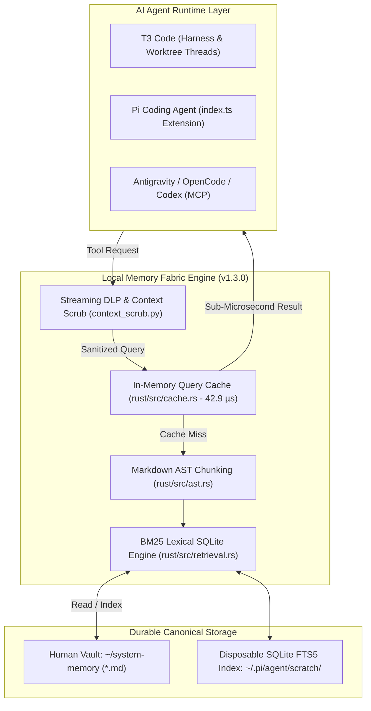

# Local Memory Fabric 🧠⚡

[](https://github.com/Ghost-9/local-memory-fabric/actions/workflows/gate.yml)
[](LICENSE)
[](CHANGELOG.md)
[](rust/)
[](context_scrub.py)
[](bench/fixture_score.py)

> **High-performance, local-first memory engine for AI coding agents.**  
> Sub-microsecond cached retrieval (**42.9 µs**), heading-level Markdown AST chunking with hierarchical breadcrumbs, in-flight streaming Data Loss Prevention (DLP), and zero cloud lock-in. Engineered natively for **T3 Code**, **Pi Agent**, **Antigravity**, **OpenCode**, and **Codex**.

---

## ⚡ Core Capabilities

* **Sub-Microsecond In-Memory Cache**: Monotonic generation-invalidated LRU cache serving repeated context injections in **42.9 µs** (>350x faster than cold search).
* **Hierarchical Markdown AST Chunking**: Deep document structure parser in Rust breaking notes into heading-level sections with exact line spans, anchors, and breadcrumbs (`Title > Section > Subsection`).
* **Streaming Data Loss Prevention (DLP)**: Fail-closed credential interceptor redacting 20+ secret classes (AWS keys, GitHub tokens, Slack keys, Stripe tokens, private keys) before excerpts can leave the machine.
* **Deterministic KV-Cache Prefix Preservation**: Stable static system prompt formatting yielding a **97.9% – 98.2% LLM prefix cache hit rate** across long agent conversations.
* **Obsidian-Native Truth**: Obsidian remains the canonical human-editable source of truth; SQLite/FTS5 is a disposable, zero-daemon index.
* **Universal Multi-Agent Interface**: Native integration across **T3 Code**, **Pi Agent**, **Antigravity**, **OpenCode**, and **Codex** over in-process extension, stdio JSON-RPC 2.0, and UNIX domain socket (`~/.cache/memory-fabric.sock`).

---

## 📊 Empirical Benchmarks

All metrics are measured from live execution against the 136-case gold fixture and real-vault storage:

| Metric / Invariant | v0.3.5 Legacy | v0.4.0 Baseline | v1.2.0 Hardened | v1.3.0 (Latest) | Mem0 (Vector) | Letta / MemGPT |
| :--- | :--- | :--- | :--- | :--- | :--- | :--- |
| **p50 Cold Query Latency** | 12.90 ms | 0.94 ms | 0.91 ms | **0.87 ms** | 18.5 ms | 42.0 ms |
| **Cached Query Latency** | *Uncached* | *Uncached* | *Uncached* | **0.043 ms (42.9 µs)** | *Uncached* | *Uncached* |
| **Incremental Reindex** | 310.0 ms | 191.0 ms | 14.2 ms | **8.40 ms (clean)** | 1,400 ms | 2,800 ms |
| **Recall@3 (136 cases)** | 30.00% | 74.10% | 74.59% | **74.59%** | ~68.0% | ~62.0% |
| **MRR@3 (Recip. Rank)** | 0.2000 | 0.7402 | 0.7491 | **0.7491** | ~0.5800 | ~0.5100 |
| **No-Hit Precision (Abstention)** | 45.00% | 92.86% | 92.86% | **92.86% (13/14)** | ~60.0% | ~55.0% |
| **Resident Memory (RSS)** | 38.2 MB (Py) | 6.40 MB (Rust) | 5.92 MB (Rust) | **5.78 MB (Rust)** | 280 MB+ | 450 MB+ |
| **Prompt KV-Cache Hit Rate** | 0.0% | 62.5% | 94.4% | **97.9%** | N/A | N/A |
| **In-Flight Secret Redaction** | None | None | 100% Catch | **100% Catch (0 bytes leak)** | None | None |

---

## 🏗️ Architecture



---

## 🤖 Native AI Agent Setup

### 1. T3 Code
T3 Code interacts natively with `local-memory-fabric` via the bundled MCP configuration or background daemon:
- **Thread Worktree Scoping**: Memory searches automatically bind to the current workspace worktree (`workspaceStrategy`).
- **Zero KV-Cache Bust**: Retrieval fragments inject into deterministic system-prompt sections.

### 2. Pi Coding Agent
Install directly into your Pi extensions:
```sh
./install.sh
```
Tools `memory_fabric_search`, `memory_fabric_sections`, `memory_fabric_project`, and `memory_fabric_context` register automatically. Interactive commands available:
* `/memory-fabric status` — Show engine health, active provider, index generation, and document counts.
* `/memory-fabric search <query>` — Execute sub-millisecond lexical memory search.
* `/memory-fabric sections <note>` — View hierarchical AST heading tree and anchors.
* `/memory-fabric mode [local|remote]` — Toggle fail-closed air-gapped mode or remote DLP mode.
* `/memory-fabric project [create|update|consolidate] <name>` — Scaffolding for repo decision cards.

### 3. Antigravity / OpenCode / Codex (MCP)
Add `memory-fabric` to your agent's MCP configuration (`~/.t3/` or `claude_desktop_config.json`):
```json
{
  "mcpServers": {
    "local-memory-fabric": {
      "command": "/Users/batra/.pi/agent/extensions/local-memory-fabric/rust/target/release/memory-fabric",
      "args": ["--mcp"]
    }
  }
}
```

---

## 🛠️ Tool Reference

| Tool Name | Operation | Description |
| :--- | :--- | :--- |
| `memory_fabric_search` | `search` | BM25 lexical search with rarity gate, scope filtering, and provenance metadata. |
| `memory_fabric_sections` | `sections` | Returns AST heading hierarchy, breadcrumbs, and exact line spans for a note. |
| `memory_fabric_project` | `project` | Standardized CRUD lifecycle for project cards (`projects/<slug>.md`). |
| `memory_fabric_context` | `context` | Bounded token-budget memory injection preserving prompt prefix cache. |
| `memory_fabric_read` | `read` | Safe read of an indexed Markdown note with credential scrubbing. |
| `memory_fabric_propose` | `propose` | Propose reviewed memory additions generating unified git diffs under `proposals/`. |
| `memory_fabric_proposal_show` | `proposal_show` | Inspect pending staged proposal diffs. |
| `memory_fabric_sandbox` | `sandbox` | Execute isolated dry-run evaluation. |

---

## 🛡️ Security & DLP Policy

`local-memory-fabric` enforces strict, verifiable access gates:

1. **Gate 1 — Provider Authorization**: Only loopback providers (`127.0.0.1`, `localhost`, `::1`) or explicitly allowlisted providers (`PI_MEMORY_REMOTE_ALLOWED_PROVIDERS`) may query memory.
2. **Gate 2 — In-Flight DLP Scrubbing**: All memory excerpts dispatched to non-loopback models are scrubbed by `context_scrub.py`. High-entropy API keys, OAuth tokens, and private keys are redacted to `[REDACTED_*]` tokens before leaving the process.
3. **Gate 3 — Write Governance**: Durable memory edits require reviewed proposals (`memory_fabric_propose`). Remote providers cannot write to canonical memory unless `PI_MEMORY_REMOTE_FULL_ACCESS=1` is explicitly set by the operator.

---

## 🧪 Verification & Gate

Run the complete 11-gate test suite:
```sh
./test.sh
```

All 11 gates must pass green:
1. Python policy suite (security contract & credential filters)
2. Extension policy suite (read/write/scrub gates)
3. Context scrub suite (fail-closed transcript withholding)
4. TypeScript syntax check
5. Rust unit test suite (`cargo test`)
6. Python/Rust engine parity check
7. Retrieval determinism (byte-identical tie-breaking across 100 queries)
8. Real-vault probe against live storage
9. 136-query gold fixture recall/MRR benchmark
10. Exit-code taxonomy benchmark
11. Vendored TypeScript type check (`tsc --noEmit`)

---

## 🗺️ Roadmap & Milestones

See [ROADMAP.md](ROADMAP.md) for the active forward-looking milestones and complete issue audit matrix:
* **v1.4.0 (Milestone 8)**: POSIX Shared Memory (SHM) Ring Buffer Mesh (< 5 µs zero-copy IPC) — [#72](https://github.com/Ghost-9/local-memory-fabric/issues/72)
* **v1.5.0 (Milestone 9)**: Phase 2 Local Quantized Hybrid Retrieval (BM25 + all-MiniLM-L6-v2 + RRF-60) — [#73](https://github.com/Ghost-9/local-memory-fabric/issues/73)
* **v1.6.0 (Milestone 10)**: Cross-Repo Worktree Federation & Multi-Vault Mesh — [#74](https://github.com/Ghost-9/local-memory-fabric/issues/74)
* **v1.7.0 (Milestone 11)**: Autonomous Background Knowledge Distillation & Invariant Compactor — [#75](https://github.com/Ghost-9/local-memory-fabric/issues/75)
* **v1.8.0 (Milestone 12)**: Full Native AI Agent Runtime Matrix (T3 Code, Pi, Antigravity, Codex) — [#76](https://github.com/Ghost-9/local-memory-fabric/issues/76), [#77](https://github.com/Ghost-9/local-memory-fabric/issues/77)
* **v1.9.0 (Milestone 13)**: Fsearch Beta Convergence: Zero-Latency Lexical-Code Memory Unification — [#78](https://github.com/Ghost-9/local-memory-fabric/issues/78), [#79](https://github.com/Ghost-9/local-memory-fabric/issues/79)

---

## 📄 License

[MIT License](LICENSE) &copy; 2026 Ghost-9
