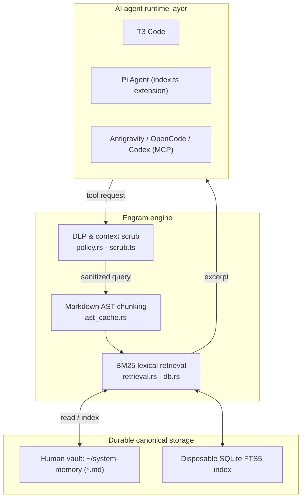

# Engram 🧠

**Engram** is the memory engine. `local-memory-fabric` is its repository and extension directory
name, kept because renaming a path breaks every configured reference.

[](https://github.com/Ghost-9/local-memory-fabric/actions/workflows/gate.yml)
[](LICENSE)
[](rust/)

> **Local-first memory for AI coding agents.** Markdown stays the canonical, human-editable source
> of truth; SQLite/FTS5 is a disposable index you can delete and rebuild. Rust engine, TypeScript
> extension, BM25 lexical retrieval, and a fail-closed DLP layer that redacts credential classes
> before an excerpt can leave the machine.

**Read § "What is measured here, and what is not" before quoting any number from this repository.**
That section is the point of this README, not a disclaimer appended to it.

---

## What is measured here, and what is not

This repository's own evidence rule is written down in [`bench/evidence/README.md`](bench/evidence/README.md):

> Write the task list, the pair count, and the analysis down before the first run. Then run it,
> publish the outcome whatever it is, and never drop a pair.
> …the only thing that separates a measurement from a story is that the analysis was chosen before
> the data existed.

That rule was written after this project published a ratio derived from a cost model with no
task-success check, and had to withdraw it. The table below applies the same rule to this README:
**every row names the file that produced it.** A number that cannot name its artifact is labelled
as such rather than presented as a result.

### Numbers with a committed artifact

| Measurement | Value | Artifact |
| :--- | :--- | :--- |
| Recall@3 — ordering A/B experiment | **93.44%** | [`bench/evidence/ordering_ab_results.json`](bench/evidence/ordering_ab_results.json) |
| Recall@3, MRR@3 — 136-case gold fixture | **74.59%** / **0.7491** | [`bench/fixture_gate.py`](bench/fixture_gate.py) |
| No-hit precision (abstention) on that fixture | **92.86%** (13/14) | [`bench/fixture_gate.py`](bench/fixture_gate.py) |

Those are two **different** measurements and must not be quoted interchangeably. The 93.44% figure
comes from a paired ordering experiment over the fixture; the 74.59% figure is the fixture's own
ranking score. Earlier versions of this README displayed `93.4%` in a badge directly above a table
reporting `74.59%`, which read as a contradiction. It was one number quoted without its scope.

### Numbers measured locally, with no committed artifact

These are real measurements taken on the author's machine, but nothing in this repository
reproduces them yet, so treat them as indicative and re-run [`bench/ab.py`](bench/ab.py) yourself:

| Measurement | Value | Status |
| :--- | :--- | :--- |
| Cached query latency | ~43 µs | no artifact; author-measured |
| Cold query p50 | ~0.87 ms | no artifact; author-measured |
| Incremental reindex (clean) | ~8.4 ms | no artifact; author-measured |

A previous revision of this README claimed cached retrieval was *">350x faster than cold search"*. That
comparison was wrong. [`CHANGELOG.md`](CHANGELOG.md) records the actual change: cached retrieval went
from an 18.1 ms uncached path to 0.043 ms, and cold p50 went 12.9 ms → 0.92 ms. So:

| Comparison | Ratio |
| :--- | :--- |
| cached vs the previous uncached path (18.1 ms → 0.043 ms) | ~420x — this is what ">350x" meant |
| cached vs **current** cold p50 (0.87–0.92 ms → 0.043 ms) | ~20x |

The multiplier is stated against a named baseline from here on, never as a bare "Nx faster".

### Deliberately excluded

Earlier revisions carried a comparison table for Mem0 and Letta (p50 latency, resident memory,
recall@3). **No artifact in this repository produced those figures**, so they are removed. A
qualitative, sourced comparison — architecture, license, who extracts memories, whether reading
sends data anywhere — lives in [`docs/COMPARISON.md`](docs/COMPARISON.md). If you want a latency
comparison, it has to be run here, against those projects, with a task-success check. That has not
been done.

### What the project has not established

The claim this plugin ultimately rests on **has never been tested**:

> Does injecting the memory block improve task success, and at what token cost?

There is no task suite where some tasks depend on knowledge held only in the vault, so there is no
result. [`bench/evidence/README.md`](bench/evidence/README.md) records this directory as
**NOT RUN** rather than filling it. Retrieval quality is measured; *usefulness* is not.

---

## Core capabilities

* **Hierarchical Markdown AST chunking** — deep document structure parsed into heading-level
  sections with exact line spans, anchors, and breadcrumbs (`Title > Section > Subsection`).
  [`rust/src/ast_cache.rs`](rust/src/ast_cache.rs)
* **BM25 lexical retrieval over SQLite FTS5** — [`rust/src/retrieval.rs`](rust/src/retrieval.rs);
  index construction in [`rust/src/index.rs`](rust/src/index.rs).
* **Fail-closed DLP** — a credential interceptor redacting 20+ secret classes (AWS keys, GitHub
  tokens, Slack keys, Stripe tokens, private keys) before excerpts can leave the machine.
  [`rust/src/policy.rs`](rust/src/policy.rs), [`scrub.ts`](scrub.ts)
* **Obsidian-native truth** — Obsidian remains the canonical source; the SQLite index is
  disposable and rebuildable at any time.
* **Multi-agent interface** — in-process extension, stdio JSON-RPC 2.0, and a UNIX domain socket.
* **Abstention as a first-class answer** — `memory_fabric_search` returns `abstained: boolean`
  plus a reason, so "nothing indexed", "nothing matched", and "matched but not discriminatively"
  are distinguishable instead of collapsing into one confident-looking payload.
  [`abstention.ts`](abstention.ts)

---

## Architecture



Engine modules: [`main.rs`](rust/src/main.rs) (CLI), [`db.rs`](rust/src/db.rs) (SQLite),
[`propose.rs`](rust/src/propose.rs) (reviewed writes), [`governance.rs`](rust/src/governance.rs)
(audit), [`federate.rs`](rust/src/federate.rs), [`harvest.rs`](rust/src/harvest.rs),
[`conflicts.rs`](rust/src/conflicts.rs), [`roll.rs`](rust/src/roll.rs).

A Python reference engine ([`memory_fabric.py`](memory_fabric.py)) is kept for parity testing
against the Rust engine.

---

## Status and versioning

Read this before quoting a version number — the repository has historically been inconsistent here.

| Thing | Current state |
| :--- | :--- |
| Version in the tree | **2.0.0** ([`package.json`](package.json), [`rust/Cargo.toml`](rust/Cargo.toml)) |
| Latest published GitHub release | **v1.3.0** |
| Tags without a release | `v1.4.0` … `v1.9.0` |
| Platform | macOS primary; Linux and Windows are not covered by CI |
| Maturity | active development, single maintainer |

The engine is usable, but the release record lags the tree: tags `v1.4.0`–`v1.9.0` exist while the
release list stops at `v1.3.0`. Treat "2.0.0" as the tree's version until a matching release is cut.

---

## Install

### Pi coding agent

```sh
./install.sh
```

Registers `memory_fabric_search`, `memory_fabric_sections`, `memory_fabric_project`,
`memory_fabric_context`, and the command surface:

* `/memory-fabric status` — engine health, active provider, index generation, document counts
* `/memory-fabric search <query>` — lexical memory search
* `/memory-fabric sections <note>` — AST heading tree and anchors
* `/memory-fabric mode [local|remote]` — toggle air-gapped or remote-with-DLP mode
* `/memory-fabric project [create|update|consolidate] <name>` — project decision cards

### Any MCP client

Point your client at the built binary. **Use an absolute path to your own checkout** — the example
below is deliberately generic:

```json
{
  "mcpServers": {
    "local-memory-fabric": {
      "command": "/ABSOLUTE/PATH/TO/local-memory-fabric/rust/target/release/memory-fabric",
      "args": ["--mcp"]
    }
  }
}
```

Build it first:

```sh
cd rust && cargo build --release
```

---

## Tool reference

| Tool | Operation | What it does |
| :--- | :--- | :--- |
| `memory_fabric_search` | `search` | BM25 lexical search with rarity gate, scope filtering, and provenance metadata |
| `memory_fabric_sections` | `sections` | AST heading hierarchy, breadcrumbs, exact line spans |
| `memory_fabric_project` | `project` | CRUD lifecycle for project cards (`projects/<slug>.md`) |
| `memory_fabric_context` | `context` | Bounded token-budget memory injection |
| `memory_fabric_read` | `read` | Safe read of an indexed note, with credential scrubbing |
| `memory_fabric_propose` | `propose` | Reviewed memory additions as unified git diffs under `proposals/` |
| `memory_fabric_proposal_show` | `proposal_show` | Inspect pending staged proposal diffs |
| `memory_fabric_sandbox` | `sandbox` | Isolated dry-run evaluation |

---

## Security & DLP policy

Three gates, all enforced in code rather than convention:

1. **Provider authorization** — only loopback providers (`127.0.0.1`, `localhost`, `::1`) or
   explicitly allowlisted providers (`PI_MEMORY_REMOTE_ALLOWED_PROVIDERS`) may query memory.
2. **In-flight DLP scrubbing** — excerpts dispatched to non-loopback models are scrubbed. High-entropy
   API keys, OAuth tokens, and private keys are replaced with `[REDACTED_*]` tokens before leaving
   the process. The scrubber **fails closed**: if it cannot classify a payload, the payload is withheld.
3. **Write governance** — durable memory edits require reviewed proposals (`memory_fabric_propose`).
   Allowlisted providers may write by default; `PI_MEMORY_REMOTE_FULL_ACCESS=0` restricts writes to
   loopback. A provider that is not allowlisted may never write, regardless of that switch.

Secret patterns live in [`rust/src/policy.rs`](rust/src/policy.rs) and the TypeScript predicate in
[`scrub.ts`](scrub.ts), with tests in [`test_memory_fabric.py`](test_memory_fabric.py) and
[`scrub.test.ts`](scrub.test.ts).

---

## Verify it yourself

```sh
./test.sh
```

A 23-step gate ([`test.sh`](test.sh)) covering the Python policy suite, the extension read/scrub/write
gates, the context scrub suite, TypeScript parse checks, the Rust unit suite, Python↔Rust parity,
retrieval determinism, a read-only probe against a real vault, the fixture recall benchmark, the
exit-code taxonomy, and a vendored type check.

`cargo test --release --locked` in `rust/` runs the Rust unit suite on its own (26 tests at the time
of writing).

**Known limitation, stated in the changelog:** gate steps 22–23 of 23 do not currently run. Step 21
aborts on a macOS TCC permission error when it reaches an iCloud Drive path; that is an environment
constraint, not a passing check. [`CHANGELOG.md`](CHANGELOG.md) records it, along with the open
`t3.json` abstention case and the measurements that were tried and rejected.

### Benchmarks

```sh
# baseline binary from any git ref, so the harness is not an archive in /tmp
BASE="$(bench/baseline.sh <commit>)"
python3 bench/ab.py "$BASE" rust/target/release/memory-fabric
python3 bench/scale.py 1130 --baseline "$BASE" --pool 40000 --rebuild
```

The method — alternating arms, medians not means, asserting `ok` on every response, and checking
output equivalence before claiming a win — is written down in [`bench/README.md`](bench/README.md),
together with a recorded case where the original hypothesis was refuted by the data.

---

## Roadmap

[`ROADMAP.md`](ROADMAP.md) carries the forward-looking list. The honest summary:

* **Open gap:** a task suite that can test whether memory injection improves task success. Until it
  exists, `bench/evidence/` stays NOT RUN.
* **Open gap:** a ≥100-query real-corpus ranking fixture. `bench/recall.py` scores 1.0 on a corpus
  generated from the terms it queries, so it cannot detect the failures the real vault had.
* **Open:** the `t3.json` abstention case, where every candidate rule was measured and rejected.

---

## License

**GNU Affero General Public License v3.0 (AGPL-3.0)** © 2026 Mayank Batra (Ghost-9). See
[`LICENSE`](LICENSE).

Under AGPL-3.0 you may run, study, modify, and redistribute this software. Derivative works and
network-accessible services built on it must also make their complete corresponding source
available under AGPL-3.0 with original copyright attribution preserved.
