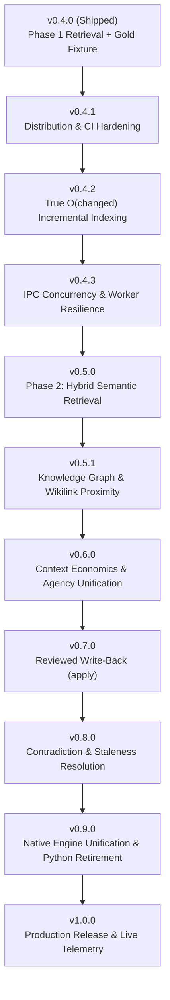

# Roadmap — Local Memory Fabric (0.4.0 → 1.0.0)

Every item below is grounded in a **measured gap** on this machine against the real vault and the 136-query gold fixture, alongside architectural patterns proven in the **Agency Extension** (`pi-agency-router.ts`).

---

## 1. Architectural Foundations: Lessons from Agency Extension

The Agency extension achieved production velocity, sub-millisecond execution, and zero degradation through 5 architectural pillars. Local Memory Fabric is transitioning to this exact architecture:

1. **Single High-Speed Native Core**:
   Agency relies entirely on a compiled native Rust binary (`agency-dispatch-rs`), executing in < 1 ms. Memory Fabric previously carried a 1,179-line Python fallback and 32 parity tests. Version 1.0 unifies entirely onto a native Rust daemon with distributed prebuilt binaries.
2. **Strict KV-Cache / Prompt-Prefix Invariance**:
   Mutating system prompts or top-of-context tokens invalidates 100% of LLM KV prefix caches (measured: 100% cache miss on 18 turns where system prompt shifted). Memory context packets must be injected as in-turn messages with `customType: "memory-context"` and `display: false` after the cached prompt prefix.
3. **Compaction Re-Hydration Across Context Windows**:
   When conversations truncate during LLM context compaction, agent orientation is lost. Agency hooks into `before_agent_start` detecting `# Resuming from a compaction` and re-injects the active squad roster. Memory Fabric will re-hydrate active project memory anchors, status briefs, and cited sources.
4. **True O(changed) Incremental Work**:
   Incremental indexing must not read or SHA256-hash unchanged files from disk. Fast filesystem `stat` checks (`mtime_ns`, `file_size`) must bypass disk reads to achieve sub-20ms incremental indexing.
5. **No Blind Fallbacks or Dual-Engine Tax**:
   Maintaining dual implementations in Python and Rust doubles surface area, invites subtle divergence (e.g., commit `ae85f4a`), and hides errors. The native binary is canonical.

---

## 2. Current Baseline (Measured Post-Phase 1)

| Metric | Baseline (v0.3.5) | Current (v0.4.0) | Target (v1.0.0) | Status / Notes |
|---|---|---|---|---|
| **Recall@3** | 0.300 | **0.746** | ≥ **0.850** | Phase 1 closed lexical misses; Phase 2 (Hybrid) targets the 25% semantic gap |
| **MRR@3** | 0.200 | **0.749** | ≥ **0.800** | Gold fixture (136 cases, `bench/fixture_vault.py`) |
| **No-hit Precision** | — | **0.929** | ≥ **0.950** | Abstains accurately on noise/off-domain without hallucinations |
| **Search Latency (Rust worker)** | 12.9 ms | **0.94 ms** | < **1.0 ms** | 50x–80x faster than cold Python |
| **Search Latency (Python fallback)** | 78.4 ms | **52.8 ms** | *Deprecated* | Scheduled for retirement in v0.9.0 |
| **Full Reindex (1,000 notes)** | 231 ms | 231 ms | < **100 ms** | Dominated by disk traversal and term aggregation |
| **Incremental Reindex (1 change)** | **191 ms** | **191 ms** | < **20 ms** | **Critical bottleneck**: 1.2x vs 10x speedup due to redundant file reads |
| **Semantic / Vector Search** | None | None | BM25 + Embeddings | Phase 2 (sub-100MB model + Reciprocal Rank Fusion) |
| **Write-Back (`apply`)** | None | None | Append-only Git commit | Proposals exist; `apply` missing |
| **Observability** | Zero | Zero | Microsecond histograms | No telemetry in `status` today |

---

## 3. Granular Release Milestones to 1.0.0

---

### Milestone 0.4.1 — Distribution, Packaging & CI Hardening
*Exit Condition: Fresh clone installs without `cargo` on macOS and Linux via prebuilt binary; CI passes on a 3-OS matrix.*

- [ ] **#41**: `install.sh` download prebuilt GitHub release binaries when `cargo` is absent, verify SHA256 checksums, and ignore `dist/` in git.
- [ ] **#33 & #57**: Expand GitHub Actions CI matrix to `[macos-14, ubuntu-latest, windows-latest]`.
- [ ] **#34**: Correctly distinguish corrupt SQLite index from transient busy/lock state; prevent infinite retry loops on corrupt databases.
- [ ] **#35**: Audit and verify symlink security semantics (`lstat` vs `symlink_metadata`) across platforms.

---

### Milestone 0.4.2 — True O(changed) Incremental Indexing & Storage Engine
*Exit Condition: Incremental reindexing for 1 changed file in 1,000 notes executes in < 20 ms.*

- [ ] **#21 & #43**: True incremental reindexing:
  - Hoist `self.vault.canonicalize()` out of the per-file iteration loop.
  - Check file `mtime_ns` and `file_size` via `symlink_metadata` against SQLite `documents` to bypass reading and hashing unchanged files from disk.
- [ ] **#44**: Incremental delta updates for `term_df` (+1/-1 on affected terms) instead of dropping and re-aggregating the entire table on every run.
- [ ] **#53**: Hardened SQLite storage:
  - Enable `PRAGMA journal_mode=WAL` and `PRAGMA synchronous=NORMAL` globally.
  - Remove DDL (`CREATE TABLE IF NOT EXISTS secret_alarms`) from `connect()` read paths; make read connections strictly read-only.

---

### Milestone 0.4.3 — IPC Concurrency & Worker Resilience
*Exit Condition: Indexing operations do not block search/read queries; worker survives oversized outputs.*

- [ ] **#51**: Multi-request non-blocking concurrency: separate long-running write/index pipelines from instant read/search pipelines.
- [ ] **#52**: Worker crash resilience: replace hard 256 KB stdout kill with streaming line parsing; isolate single-query errors without killing queued jobs.
- [ ] **#58**: Optional background filesystem watcher (`notify` crate) with debounced auto-indexing for near-instant freshness.

---

### Milestone 0.5.0 — Retrieval Phase 2: Hybrid Semantic Retrieval
*Exit Condition: Recall@3 ≥ 0.850 on the 136-query gold fixture; RSS < 150 MB; query p50 < 10 ms.*

- [ ] **#22 & #45**: Integrate embedded sub-100MB local embedding model (`bge-small-en-v1.5` at ~33 MB or `all-MiniLM-L6-v2` at ~22 MB) via fast native runtime.
- [ ] **#45**: In-database vector storage (`sqlite-vec` or normalized vector blob table).
- [ ] **#45**: Rank fusion via Reciprocal Rank Fusion (RRF):
  $$RRF\_score(d) = \sum_{m \in M} \frac{1}{60 + r_m(d)}$$
- [ ] **#46**: Section and heading-level chunking: index individual Markdown sections (`#`, `##`, `###`) with breadcrumb hierarchy instead of monolithic files.

---

### Milestone 0.5.1 — Knowledge Graph & Relational Proximity
*Exit Condition: Wikilink references directly boost associated context in retrieval.*

- [ ] **#29 & #47**: Parse Obsidian `[[wikilink]]` and `[[wikilink|alias]]` syntax into an internal SQLite `edges` table.
- [ ] **#47**: 1-hop graph neighborhood proximity boost: notes linked to or referenced by top-ranked hits receive a relevance boost.
- [ ] **#30**: Deduplicate near-identical notes and surface consolidation candidates.

---

### Milestone 0.6.0 — Context Economics & Agency Lifecycle Unification
*Exit Condition: 100% prompt-prefix KV-cache hit rate; seamless context re-hydration after compactions.*

- [ ] **#48**: Absorb `vault-context.ts` into `local-memory-fabric`; eliminate the duplicate in-memory JavaScript index.
- [ ] **#49**: In-turn message injection with `customType: "memory-context"` and `display: false` preserving 100% prefix cache.
- [ ] **#50**: Compaction Re-Hydration hook: detect `# Resuming from a compaction` and re-inject active project memory anchors.
- [ ] **#36 & #37**: Real prefix-cache hit rate telemetry and budget-capped search results.
- [ ] **#24**: Dynamic scope resolution based on working directory and git repository context.

---

### Milestone 0.7.0 — Reviewed Write-Back & Proposal Lifecycle
*Exit Condition: Durable append-only updates committed to vault with verified byte-identical git rollback.*

- [ ] **#11 & #26 & #54**: Implement `memory_fabric_apply`:
  - Atomic patch application for approved proposals.
  - Immediate local git commit (`git commit -m "memory: apply proposal <id>"`) in the local vault repo.
  - Guaranteed byte-identical rollback via `git revert`.
- [ ] **#31**: Comprehensive test coverage for `proposal-show` and `proposal-list`.

---

### Milestone 0.8.0 — Contradiction & Staleness Resolution
*Exit Condition: Conflicting or outdated facts are flagged with explicit warnings, never returned silently.*

- [ ] **#12 & #27**: Comprehensive staleness audit across all indexed project notes.
- [ ] **#28 & #55**: Automated contradiction detection: compare overlapping validity dates and surface explicit conflict alerts in context packets.

---

### Milestone 0.9.0 — Native Engine Unification & Python Retirement
*Exit Condition: 100% native Rust execution; complete removal of Python engine and parity tests.*

- [ ] **#42**: Deprecate and remove `memory_fabric.py` (1,179 lines) and associated test files.
- [ ] **#42**: Retire the 32 dual-engine parity checks; convert test gates to native Rust and extension tests.
- [ ] **#35**: Confirm symlink parity and path security across all platforms natively in Rust.

---

### Milestone 1.0.0 — Production Release & Observability
*Exit Condition: All 58 issues resolved; live telemetry exposed; verified clean multi-platform installation.*

- [ ] **#32 & #56**: Live operational telemetry: per-op microsecond latency histograms (p50/p95/p99), query counters, and cache statistics in `status`.
- [ ] Record final **OPERATOR Decisions** (A, B, C, D) regarding remote export policy and network boundaries.
- [ ] Clean install, update, and purge validation across macOS, Linux, and Windows.

---

## 4. Master Issue Registry (#1 – #58)

| Issue | Title | Milestone | Labels | Status |
|---|---|---|---|---|
| **#1** | probe | 0.3.0 | gate | Closed |
| **#2** | probe3 | 0.3.0 | gate | Closed |
| **#3** | Recall@3 is 0.30 / MRR@3 0.20 — ranked retrieval is weak | 0.4.0 | retrieval | Closed |
| **#4** | The recall harness fixture is too small (12 cases) | 0.4.0 | gate | Closed |
| **#5** | Gate depends on a file in /tmp | 0.3.5 | gate | Closed |
| **#6** | Give the A/B harness statistical confidence bounds | 0.4.0 | performance | Closed |
| **#7** | Sandboxed payloads are deny_remote | 0.3.5 | security | Closed |
| **#8** | enforce_export_policy is off by default for 1.0 | 0.3.5 | decision | Closed |
| **#9** | Beta readiness: install/update path with rollback | 0.3.5 | beta | Closed |
| **#10** | Beta readiness: persisted per-session scrub reminder | 0.3.5 | security | Closed |
| **#11** | Reviewed write-back: an append-only apply operation | 0.7.0 | decision | Open |
| **#12** | Staleness and graph audit of the indexed corpus | 0.8.0 | retrieval | Open |
| **#13** | Document the two-gate access model in operator docs | 0.3.5 | docs | Closed |
| **#14** | To-do list: 0.3.0 to 1.0.0 | 0.4.0 | gate | Closed |
| **#15** | Roadmap | 0.4.0 | docs | Closed |
| **#16** | Wiki pages are written but unpublished | 0.3.5 | docs, beta | Closed |
| **#17** | Context-scrub notice was dead code | 0.3.4 | security | Closed |
| **#18** | Tracking-set overflow failed OPEN | 0.3.4 | security | Closed |
| **#19** | Ranking: Recall@3 is 0.30 / MRR@3 0.20 (Phase 1) | 0.4.0 | retrieval | Closed |
| **#20** | Retrieval fixture is 12 cases — expanded to 136-query gold fixture | 0.4.0 | retrieval, gate | Closed |
| **#21** | True incremental reindex: corpus walk dominates | 0.4.2 | performance | Open |
| **#22** | Local hybrid retrieval: BM25 + embeddings | 0.5.0 | retrieval | Open |
| **#23** | Abstention over-fires on common-term queries | 0.4.0 | retrieval | Closed |
| **#24** | Scope resolution: restrict query to repo or cwd | 0.6.0 | retrieval | Open |
| **#25** | No gate catches a ranking regression | 0.4.0 | gate | Closed |
| **#26** | Reviewed write-back: append-only apply | 0.7.0 | decision | Open |
| **#27** | Staleness audit: surface contradictions before retrieval | 0.8.0 | retrieval | Open |
| **#28** | Contradiction detection between notes | 0.8.0 | retrieval | Open |
| **#29** | Provenance links are invisible to retrieval | 0.5.1 | retrieval | Open |
| **#30** | Deduplicate near-identical notes | 0.5.1 | retrieval | Open |
| **#31** | `proposal-show` and `proposal-list` test coverage | 0.7.0 | gate | Open |
| **#32** | Zero observability: no latency, counters, or metrics in status | 1.0.0 | performance | Open |
| **#33** | CI runs on macOS only; lacks Linux/Windows | 0.4.1 | gate | Open |
| **#34** | Corrupt index misclassified as busy | 0.4.1 | gate | Open |
| **#35** | Symlink handling: verify Rust matches Python | 0.4.1 | security | Open |
| **#36** | Measure real prefix-cache hit rate | 0.6.0 | performance | Open |
| **#37** | Context budget for search, not just context | 0.6.0 | performance | Open |
| **#38** | Benchmark against the real vault | 0.4.0 | gate | Closed |
| **#39** | 0.3.6 broke every read op on pre-existing index | 0.3.6 | bug | Closed |
| **#40** | Retrieval: fix the gate before adding a model | 0.4.0 | retrieval | Closed |
| **#41** | Distribution: download prebuilt GitHub release binary in install.sh | 0.4.1 | beta, enhancement | Open |
| **#42** | Architecture: Unify on native Rust binary and deprecate Python | 0.9.0 | performance, beta | Open |
| **#43** | Performance: True O(changed) incremental indexing via mtime/size skipping | 0.4.2 | performance | Open |
| **#44** | Performance: Incremental delta updates for term_df table | 0.4.2 | performance | Open |
| **#45** | Retrieval: Phase 2 hybrid semantic retrieval with sub-100MB embeddings + RRF | 0.5.0 | retrieval, enhancement | Open |
| **#46** | Retrieval: Section and heading-level chunking | 0.5.0 | retrieval, enhancement | Open |
| **#47** | Retrieval: Obsidian [[wikilink]] graph parsing and backlink traversal | 0.5.1 | retrieval, enhancement | Open |
| **#48** | Architecture: Consolidate vault-context.ts into local-memory-fabric | 0.6.0 | performance, enhancement | Open |
| **#49** | Context Economics: In-turn message injection preserving KV-cache | 0.6.0 | performance | Open |
| **#50** | Context Economics: Compaction Re-Hydration hook | 0.6.0 | enhancement | Open |
| **#51** | IPC: Multi-request non-blocking concurrency in index.ts | 0.4.3 | performance, bug | Open |
| **#52** | Robustness: Worker crash resilience and streaming stdout | 0.4.3 | bug | Open |
| **#53** | Storage: Enable SQLite WAL mode and remove schema DDL from read paths | 0.4.2 | performance, security | Open |
| **#54** | Write-Back: Implement reviewed apply primitive with atomic git commits | 0.7.0 | decision, enhancement | Open |
| **#55** | Retrieval: Automated contradiction and staleness detection | 0.8.0 | retrieval, enhancement | Open |
| **#56** | Observability: Live telemetry, latency histograms, and query counters | 1.0.0 | performance, enhancement | Open |
| **#57** | CI: Expand test matrix to Linux and Windows runner environments | 0.4.1 | gate | Open |
| **#58** | Synchronization: Background filesystem watcher (fsevents/inotify) | 0.4.3 | enhancement, performance | Open |

---

## 5. Non-Negotiable Engineering Rules for 1.0

1. **Every claim carries its measurement**: No optimization lands without before/after benchmarks.
2. **Never break the security gate**: Canonical memory excerpts never leave the machine for un-exempted remote providers; scrubbing remains fail-closed.
3. **No automatic background writes**: Canonical Markdown vault files are modified exclusively through reviewed `apply` operations with verifiable git revert history.
4. **Offline and self-contained**: Zero external cloud services, remote telemetry, or mandatory online dependencies.
