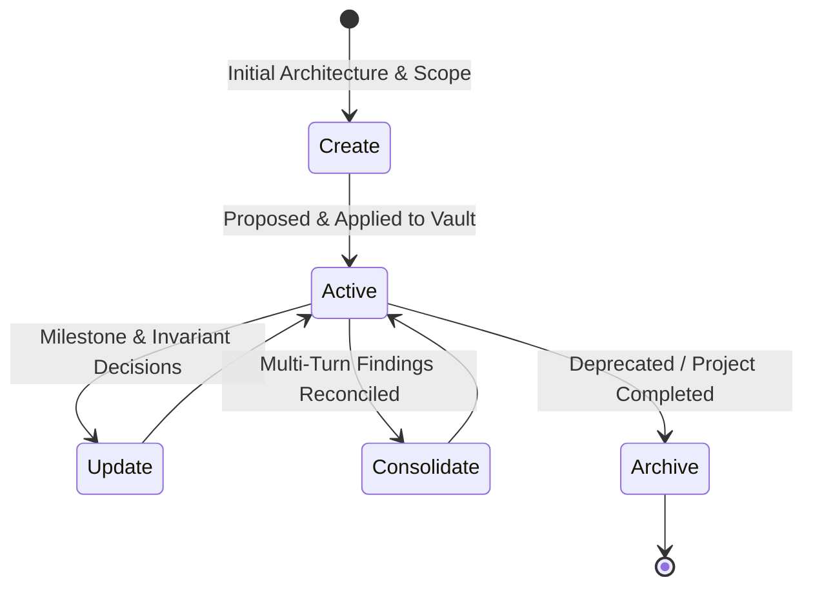

# Standardized Project Memory Lifecycle & Single-Switch Provider Automation

**Memory Fabric v1.1.0 Specification**

This document establishes the canonical specification for project-wise memory lifecycle management and the unified single-switch provider automation protocol.

---

## 1. Single-Switch Provider Automation

Historically, switching between local models (Ollama, llama.cpp, LM Studio) and remote models (Anthropic Claude, OpenAI, Google Gemini, OpenCode) required configuring multiple fragmented environment variables (`PI_MEMORY_LOCAL_PROVIDERS`, `PI_MEMORY_REMOTE_ALLOWED_PROVIDERS`, `PI_MEMORY_REMOTE_FULL_ACCESS`, `PI_MEMORY_EXPORT_POLICY`).

### Unified Operating Modes

Memory Fabric v1.1.0 unifies all access, context-scrubbing, and write permissions behind a single runtime switch:

| Mode | Trigger / Command | Read Access | Write / Proposals | Context Scrubbing | Use Case |
|---|---|---|---|---|---|
| **LOCAL** (Default) | `PI_MEMORY_MODE=local`<br/>`/memory-fabric mode local` | Loopback only (`127.0.0.1`, `localhost`) | Loopback only | Remote turns scrubbed | Maximum privacy, strictly fail-closed, zero cloud exposure |
| **REMOTE** | `PI_MEMORY_MODE=remote`<br/>`/memory-fabric mode remote` | Any active model | Fully enabled | Never scrubbed | Autonomous coding agents (T3 Code, Pi Agent, OpenCode, Codex) |

### Interactive Runtime Flipping
Operators can flip between modes at runtime without restarting the daemon or modifying shell dotfiles:
```bash
/memory-fabric mode remote   # Flips active session to autonomous remote mode
/memory-fabric mode local    # Restores strict fail-closed loopback isolation
/memory-fabric mode          # Inspects current active mode and provider state
```

---

## 2. Standardized Project Memory Lifecycle

Every project indexed by Memory Fabric follows a standardized lifecycle in `projects/<project-name>.md`.



### Standardized Project Card Template
Every project note adheres to standard YAML frontmatter:
```markdown
---
type: project
status: active
created: "YYYY-MM-DD"
updated: "YYYY-MM-DD"
tags: [project, <project-name>]
---

# <Project Title>

## Overview
High-level purpose, repository URL, and core mission.

## Architecture & Invariants
- Core constraints, fail-closed contracts, non-negotiable patterns.
- Subsystems, database schemas, and IPC mechanisms.

## Status & Next Milestones
- Active blockers and immediate priorities.
- Chronological decision record with dates.
```

---

## 3. Project Lifecycle Operations

Agents and operators invoke project lifecycle actions using either the `memory_fabric_project` tool or the `/memory-fabric project` command:

### 1. `create` (Scaffold Project Card)
- **Action**: Initializes a standardized project card with frontmatter and core section headers.
- **CLI**: `/memory-fabric project create <name> "Project overview..."`
- **Tool**: `memory_fabric_project({ action: "create", project: "<name>", content: "..." })`

### 2. `update` (Section-Level Append & Versioning)
- **Action**: Updates a specific section (e.g. `## Architecture & Invariants` or `## Status & Next Milestones`) while bumping `updated: "YYYY-MM-DD"`.
- **CLI**: `/memory-fabric project update <name> "New decision added..."`
- **Tool**: `memory_fabric_project({ action: "update", project: "<name>", section: "Decisions", content: "..." })`

### 3. `consolidate` (Eliminate Duplication & Synthesize)
- **Action**: Reconciles fragmented session notes or scratchpads into the canonical project card. Removes obsolete temporary items and deduplicates overlapping facts under `## Consolidated Milestones`.
- **CLI**: `/memory-fabric project consolidate <name> "Consolidated decisions..."`
- **Tool**: `memory_fabric_project({ action: "consolidate", project: "<name>", content: "..." })`

### 4. `archive` (Deprecate Project Card)
- **Action**: Marks frontmatter `status: archived` and appends `archived_at: "YYYY-MM-DD"`. Prevents search results from polluting current active project contexts while retaining full historical provenance.
- **CLI**: `/memory-fabric project archive <name>`
- **Tool**: `memory_fabric_project({ action: "archive", project: "<name>" })`

### 5. `status` (Inspect Project Card)
- **Action**: Reads the current canonical state of `projects/<name>.md`.
- **CLI**: `/memory-fabric project status <name>`
- **Tool**: `memory_fabric_project({ action: "status", project: "<name>" })`

---

## 4. Write-Back & Rollback Safety

All write operations (`create`, `update`, `consolidate`, `archive`) flow through the standard proposal pipeline:
1. Operations generate a reviewed proposal in `~/.pi/agent/scratch/memory-fabric/proposals/<id>.json`.
2. Proposals are inspected via `/memory-fabric proposals`.
3. Proposals are applied via `/memory-fabric apply <id>`.
4. In the event of a mistake or hallucination, any proposal can be reversed immediately with `/memory-fabric revert <id>`.
